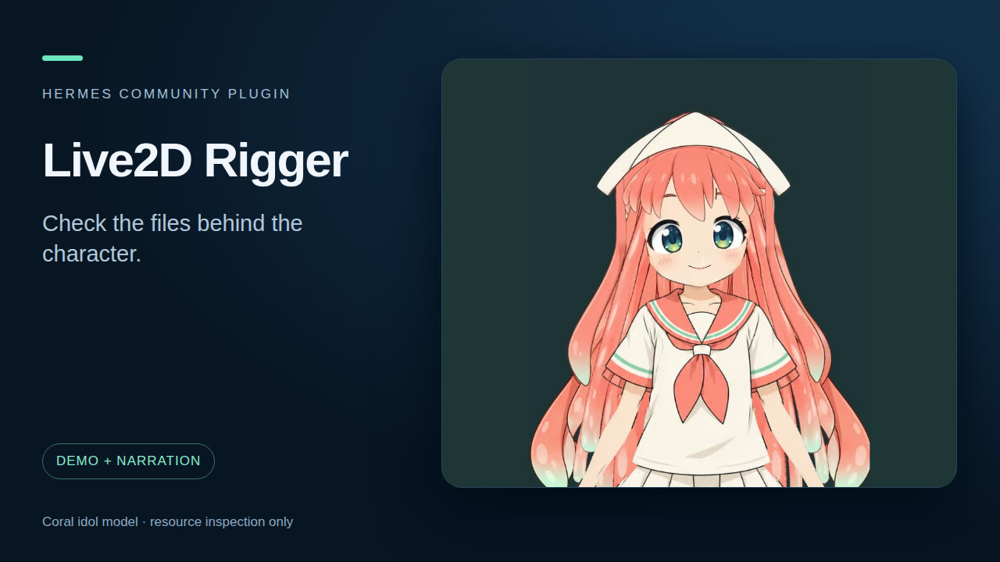

# Live2D Rigger

Create and rig an editable Live2D character from a brief, through complete layered artwork, native compilation and motion review.

**At a glance**

- **Install:** `hermes plugins install flabanabba8/live2d-rigger`, then `hermes plugins enable live2d-rigger`.
- **Needs:** Hermes 0.22 or later and Python Pillow (installed from the manifest). You must supply your own Live2D files: the Cubism SDK viewer folder (LIVE2D_SDK_VIEWER, which holds Live2D Cubism Core), a Python with Playwright (LIVE2D_RENDER_PYTHON) and ffmpeg for rendering clips, and a model you are allowed to use. This plugin bundles no Live2D SDK, Cubism Core, viewer, sample model or character artwork.
- **Internet:** Nothing by default. The sample tool can download one official free sample model from Live2D's own sample-data host into the plugin data folder, only after you have read and accepted Live2D's licence terms yourself and told Hermes so. Rendering is local.
- **Limits:** Linux is the only platform checked. Your Live2D SDK files and Live2D's licence terms (Free Material License Agreement, SDK licence, sample terms) are yours to obtain and accept; the plugin does not accept them for you. It edits a copy of a model, never the original, changes physics and writes motion, but it cannot rebuild a MOC or edit deformers. Whether a motion looks good is a human judgement.
- **Credits:** Live2D, Cubism and the sample models belong to Live2D Inc.; nothing from them is bundled and their licences apply to anything you download or load. Licence: GPL-3.0-or-later.
- **AI assistance:** Written with AI coding assistants (Anthropic Claude and OpenAI Codex agents) under the maintainer's direction; what was actually tested is listed in VERIFICATION.md.

Read the [setup/task guide](llmwiki/task-guide.md) and [skill](skills/live2d-rigger/SKILL.md) for the production workflow, resource choices and observable acceptance.

## Characters you already have (0.4.0)

`live2d_open_model` copies an existing model (a `.model3.json` folder) into a project so the original is never touched. `live2d_inspect_model` explains how she is put together (controls, expressions, motions, physics, and with the renderer ready the separate parts and each control range). `live2d_adjust_physics` changes how hair or skirt swing, `live2d_write_motion` writes a new idle motion from plain curve descriptions, and `live2d_render_clip` renders a labelled clip through the official Cubism Core so before and after compare frame for frame. Rendering uses your own Cubism SDK viewer folder (`LIVE2D_SDK_VIEWER`), a Python with Playwright (`LIVE2D_RENDER_PYTHON`) and ffmpeg; Cubism Core is not bundled.

## Reference samples

`live2d_reference_samples` lists five official free Live2D sample models (Hiyori, Haru, Mark-kun, Mao, Ren) and summarises a present sample's parameters, parts, physics, expressions and motion groups. `live2d_fetch_reference_sample` downloads one from Live2D's own sample-data host into this plugin's data folder, only when told the user agreed to Live2D's licence. They are structural references only; no sample is bundled, and sample artwork must never be copied into a user's model. See [references](llmwiki/references.md).

## Supporting tools and detailed limits

Inspect common resource references in a Cubism `model3.json` file, reporting missing, invalid or unsafe model, texture, physics, pose, userdata, display-info, expression, motion and motion-sound paths. A second tool checks motion segment structure and compares motion targets to IDs in a supplied display-info file. The source files are read only; model, display-info and motion JSON reads reject a file changed or atomically replaced during the bounded read. [Live2D's SDK documentation](https://docs.live2d.com/en/cubism-sdk-tutorials/model-add-to-sample-project/) describes the model settings format.

The diagnostic inspectors are static analysis. They do not parse the MOC3 binary, validate texture contents, load or render a model, exercise parameters, detect clipping/deformation, or inspect every Cubism extension. Production uses the explicitly selected native authoring and rendering tools described in the guide. A present file is not proof of a usable rig. Test in the intended Cubism runtime and visually review the animation. Only synthetic fixtures have been tested; no existing user model has been modified or reviewed.

Motion checks follow Live2D's [motion format](https://github.com/Live2D/CubismSpecs/blob/master/FileFormats/motion3.json.md) and [display-info format](https://github.com/Live2D/CubismSpecs/blob/master/FileFormats/cdi3.json.md). A missing display-info ID is a warning, not proof that the MOC lacks it. Seven synthetic tests pass; no real motion package or rendered rig has been checked.
